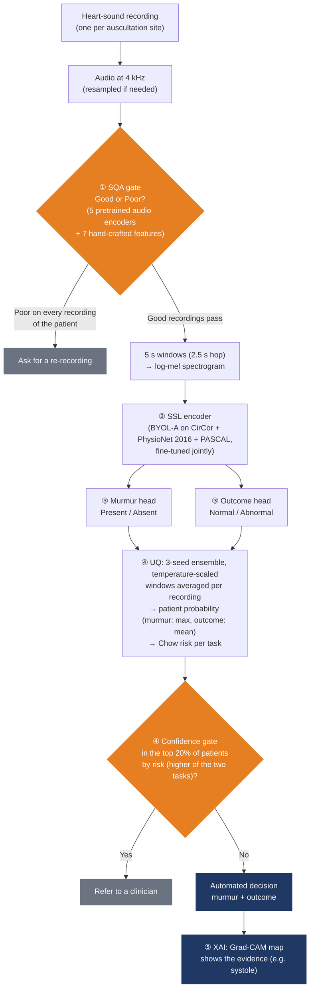

# MySteth 2.0

**Trustworthy paediatric heart-sound screening: code, results and reports**

MySteth 2.0 screens children's heart-sound recordings for murmurs and abnormal clinical outcome. It combines five components:

1. ① signal-quality assessment (SQA), a gate that asks for a re-recording when the audio is unusable;
2. ② a self-supervised (SSL) audio encoder;
3. ③ multi-task prediction of murmur and outcome;
4. ④ uncertainty quantification (UQ), with a confidence gate that refers uncertain cases to a clinician;
5. ⑤ explanations (XAI).

The study tests the hypothesis that *trustworthy cardiac screening emerges from the interaction between recording quality, learned representations, uncertainty estimation and explainability, not from any single component*. It does so through seven research questions, on the CirCor DigiScope dataset (942 patients, 3,163 recordings), with a zero-shot external check on ZCHSound (1,259 children).

---

| Part of the pipeline | Built and tested in |
|---|---|
| ① SQA gate | [`00_SQA`](00_SQA/) (model), [`RQ1`](RQ1/) (its link to uncertainty) |
| ② SSL encoder | [`RQ2`](RQ2/) |
| ③ Shared encoder with murmur and outcome heads (the system model) | [`RQ3`](RQ3/) |
| ④ Uncertainty, Chow risk and the confidence gate | [`RQ4`](RQ4/) |
| ⑤ Grad-CAM explanations | [`RQ5`](RQ5/) |
| The whole pipeline, with each component removed in turn | [`RQ6`](RQ6/) |
| The whole pipeline on new data (ZCHSound) | [`RQ7`](RQ7/) |

---

## Start here

| If you want… | Go to |
|---|---|
| The research questions and methods | [`RQs and Methods.pdf`](RQs%20and%20Methods.pdf) |
| The final system's patient-level results | [`final_system/patient_level/`](final_system/patient_level/) |
| The trained models (system model + SQA model) | Release [**models-v1**](https://github.com/Tusharr-Bansal/MySeth-2.0/releases/tag/models-v1) → `mysteth2_models.zip` |
| The temperatures and thresholds the models use | [`final_system/model_config/`](final_system/model_config/) |
| A component or research question | the table below: each folder starts with its report (PDF) |
| Data and files that are not in this repo | [`Data_Links_Not_In_This_Repo.md`](Data_Links_Not_In_This_Repo.md) and [`large_files/`](large_files/) |

---

## The research questions at a glance

| Folder | Question | Report | Code | Outputs | Not in this repo |
|---|---|---|---|---|---|
| [`00_SQA`](00_SQA/) | Component 1: is a recording good enough to assess? | [PDF](00_SQA/MySteth2_Component1_SQA_Final.pdf) | [notebook](00_SQA/code/sqa-model-redone.ipynb) | [outputs](00_SQA/outputs/) · [inputs](00_SQA/inputs/) | [list](large_files/00_SQA_Large_Files.md) |
| [`RQ1`](RQ1/) | Does SQA filtering change what the model is uncertain about? | [PDF](RQ1/MySteth2_RQ1_SQA_Uncertainty.pdf) | [notebook](RQ1/code/rq1-version-3.ipynb) | [outputs](RQ1/outputs/rq1_outputs/) | [list](large_files/RQ1_Large_Files.md) |
| [`RQ2`](RQ2/) | How does self-supervised representation learning affect uncertainty quality and calibration? | [PDF](RQ2/MySteth2_RQ2_SSL_vs_Scratch.pdf) | [part a](RQ2/code/rq2-part-1-again.ipynb) · [part b](RQ2/code/rq2-part-2-again.ipynb) | [part a](RQ2/outputs/part_a/rq2a_outputs/) · [part b](RQ2/outputs/part_b/rq2_outputs/) | [list](large_files/RQ2_Large_Files.md) |
| [`RQ3`](RQ3/) | Does a shared multi-task encoder produce uncertainty that is consistent across tasks? | [PDF](RQ3/MySteth2_RQ3_MultiTask_Uncertainty.pdf) | [notebook](RQ3/code/rq3-redone.ipynb) | [outputs](RQ3/outputs/rq3_outputs/) | [list](large_files/RQ3_Large_Files.md) |
| [`RQ4`](RQ4/) | Does confidence-based rejection improve calibration, or just discard hard cases? | [PDF](RQ4/MySteth2_RQ4_Rejection_Calibration.pdf) | [notebook](RQ4/code/rq4-redone.ipynb) | [outputs](RQ4/outputs/rq4_outputs/) | [list](large_files/RQ4_Large_Files.md) |
| [`RQ5`](RQ5/) | Do explanations align with what the model is confident about? | [PDF](RQ5/MySteth2_RQ5_Explanations_Confidence.pdf) | [notebook](RQ5/code/rq5-version-3.ipynb) | [outputs](RQ5/outputs/rq5_outputs/) | [list](large_files/RQ5_Large_Files.md) |
| [`RQ6`](RQ6/) | Is the integrated system, with its two gates, more clinically trustworthy than any single component, including knowing when to defer to a clinician? (end to end, with ablations) | [PDF](RQ6/MySteth2_RQ6_End_to_End.pdf) | [notebook](RQ6/code/rq6-redone.ipynb) | [outputs](RQ6/outputs/rq6_outputs/) | [list](large_files/RQ6_Large_Files.md) |
| [`RQ7`](RQ7/) | Does the finished system, trained only on CirCor, transfer to an independent paediatric dataset (ZCHSound)? | [PDF](RQ7/MySteth2_RQ7_External_Validation.pdf) | [notebook](RQ7/code/rq7-external.ipynb) | [outputs](RQ7/outputs/rq7_outputs/) | [list](large_files/RQ7_Large_Files.md) |

---

## How to read a folder

Every component and research question folder has the same layout:

```
RQ4/
├── MySteth2_RQ4_Rejection_Calibration.pdf   ← the report: read this first
├── README.md
├── code/
│   └── rq4-redone.ipynb                     ← the Kaggle notebook, saved with its printed outputs
└── outputs/
    └── rq4_outputs/                         ← every CSV the report's tables are built from
        └── figures/                         ← the figures in the report
```

- **Report → files.** The RQ4–RQ7 reports end with a *Files* section naming the CSV behind each table. In the other folders, the CSV names follow the report's topics (for example `rq3_correlations.csv` for RQ3's correlation tables).
- **Notebook sections.** Notebooks are divided into numbered sections. In RQ1–RQ6, each section opens with a note saying which of the five components it uses.

Three folders differ slightly:

| Folder | Difference |
|---|---|
| `00_SQA/` | Has an `inputs/` folder with the hand labels (`circor_main_labels.csv`) and the hand-crafted features (`recording_features_full_v2.csv`); its outputs sit directly in `outputs/`. |
| `RQ2/` | Two notebooks: **part a** pretrains the SSL encoders and writes the shared folds file; **part b** trains and compares the five encoder arms. Their outputs are in `outputs/part_a/` and `outputs/part_b/`. |
| `RQ7/` | Also holds the ZCHSound paper (PDF). `outputs/ZCHSound/` contains the notebook's working copies of ZCHSound's two label files; the audio stays on Kaggle. |

---

## Where each notebook's inputs come from

Apart from the datasets, each notebook reads the outputs of earlier notebooks. The small output files are in this repo, in each folder's `outputs/`. The large ones (trained networks, per-unit predictions, embeddings) stay on Kaggle and are listed, with links, in that folder's file in [`large_files/`](large_files/). Each of those files also lists every input of its notebook, read from the notebook's Kaggle settings.

| Notebook | Earlier outputs it reads | Data and other inputs |
|---|---|---|
| SQA | — | CirCor audio; the hand labels and features (`00_SQA/inputs/`); cached embeddings; pretrained audio encoders (PANNs, AST, CLAP, HeAR) |
| RQ2 part a | — | CirCor, PhysioNet/CinC 2016 and PASCAL audio |
| RQ2 part b | RQ2 part a; the Scratch arm of an earlier RQ2 run with identical folds and code | CirCor audio |
| RQ3 | RQ2 part a, RQ2 part b, SQA (`sqa_oof_predictions.csv`) | CirCor audio |
| RQ4 | RQ3 | CirCor audio |
| RQ1 | RQ4, SQA (`sqa_oof_predictions.csv`) | — |
| RQ5 | RQ3, RQ4, SQA (`sqa_oof_predictions.csv`) | CirCor audio and segmentation files |
| RQ6 | RQ2 part b, RQ3, RQ4, SQA (`sqa_oof_predictions.csv`) | — |
| RQ7 | RQ3 (trained networks), SQA (final model, hand-crafted features, embeddings) | ZCHSound and CirCor audio; pretrained audio encoders |

**Paths inside the notebooks.** The notebooks ran on Kaggle and read from `/kaggle/input/...`:

| Path in a notebook | Folder in this repo |
|---|---|
| `/kaggle/input/notebooks/tusharrbb/<notebook>/...` | the `outputs/` folder of that notebook's RQ |
| `/kaggle/input/datasets/tusharrbb/sqa-oof-predictions/...` | `00_SQA/outputs/sqa_oof_predictions.csv` |
| `/kaggle/input/datasets/tusharrbb/labels-mannual/...` and `.../sqa-helpers/...` | `00_SQA/inputs/` |

| Kaggle notebook | Folder |
|---|---|
| `sqa-model-redone` | `00_SQA` |
| `rq1-version-3` | `RQ1` |
| `rq2-part-1-again` | `RQ2` (part a) |
| `rq2-part-2-again` | `RQ2` (part b) |
| `rq3-redone` | `RQ3` |
| `rq4-redone` | `RQ4` |
| `rq5-version-3` | `RQ5` |
| `rq6-redone` | `RQ6` |
| `rq7-external` | `RQ7` |

---

## Order to read or re-run the notebooks

**SQA → RQ2 part a → RQ2 part b → RQ3 → RQ4 → RQ1 → RQ5 → RQ6 → RQ7**

Each notebook only uses outputs of notebooks before it in this order (table above). RQ1 is numbered first but comes after RQ4, because it relates the SQA score to the uncertainty of the system model built in RQ3 and scored in RQ4. RQ6 combines everything, and RQ7 applies the finished system to new data.

---

## Shared and final files

| Path | What it is |
|---|---|
| [`shared/rq2_folds.csv`](shared/rq2_folds.csv) | The fold (0–2) and role per fold (train / val / cal / test) of every CirCor recording, with patients grouped (repeat visits linked). Created by RQ2 part a; the 3 folds in it are the ones every model from RQ2 onward was trained and evaluated on. Identical copies sit in RQ2's and RQ3's outputs. |
| [`final_system/patient_level/rq6_patient_decisions.csv`](final_system/patient_level/rq6_patient_decisions.csv) | CirCor: one row per patient, task and configuration (full system, baseline and each ablation), with probability, threshold, risk, SQA pass, deferral and the automated decision. |
| [`final_system/patient_level/rq7_children.csv`](final_system/patient_level/rq7_children.csv) | ZCHSound: one row per child, with diagnosis, CHD label, SQA score and pass, both heads' probabilities and decisions, and full-system deferral. |
| [`final_system/model_config/`](final_system/model_config/) | Temperatures and decision thresholds: per fold for CirCor (RQ4, RQ6), fold-averaged for new data (RQ7). |
| Release [models-v1](https://github.com/Tusharr-Bansal/MySeth-2.0/releases/tag/models-v1) | `mysteth2_models.zip`: the system model (9 networks: joint Domain-SSL encoder with murmur and outcome heads, 3 folds × 3 seeds), the final SQA model (`sqa_final_model.joblib`) and the config files. |

---

## Repository map

```
MySeth-2.0/
├── README.md                          ← this file
├── RQs and Methods.pdf                ← research questions, hypothesis and methods
├── Data_Links_Not_In_This_Repo.md     ← datasets, pretrained models and Kaggle outputs, with links
├── 00_SQA/                            ← Component 1: signal-quality assessment
├── RQ1/ … RQ7/                        ← one folder per research question
├── shared/                            ← rq2_folds.csv, used by every RQ
├── final_system/                      ← patient-level CSVs and model settings
└── large_files/                       ← one file per folder: its inputs (with links) and its outputs kept on Kaggle
```

## How MySteth 2.0 works




**Not in this repo:**
- the audio datasets (CirCor, ZCHSound, PhysioNet/CinC 2016, PASCAL);
- the pretrained audio encoders used by the SQA;
- trained network weights other than the final system's;
- large intermediate files (per-unit predictions, embeddings, explanation maps).

Every one of these is linked in [`large_files/`](large_files/) and [`Data_Links_Not_In_This_Repo.md`](Data_Links_Not_In_This_Repo.md).
